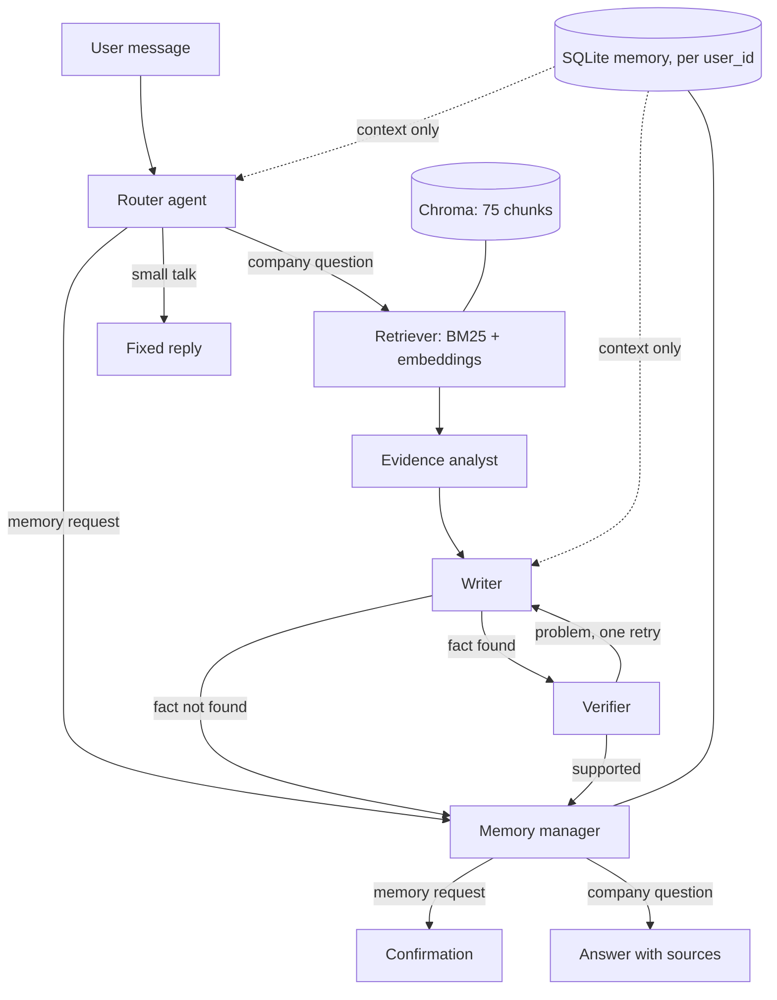

# Design note

## Architecture

## Agents
| Agent | Responsibility |
|---|---|
| Router | Classifies the message and rewrites follow-ups into standalone queries |
| Retriever | Hybrid search: BM25 keywords plus local embeddings, merged with Reciprocal Rank Fusion |
| Evidence analyst | Chooses current evidence, flags outdated chunks, explains conflicts, decides if the fact exists |
| Writer | Writes a cited answer from the chosen evidence only |
| Verifier | Checks every claim against the evidence and triggers one retry |
| Memory manager | Adds, updates or deletes user memory under strict rules |

## Information flow
(A question enters the router, goes through retrieval, analysis, writing and verification, then the memory manager runs. Mention that memory is passed to the router and writer as context only.)

## Memory approach
- **Stored:** preferences, ongoing topics, user-stated claims (labelled unverified).
- **Not stored:** secrets, contact details, sensitive personal topics, company facts. A regex filter redacts secrets before anything reaches the model, memory or LangSmith, and a second check blocks unsafe notes in code.
- **Isolation:** every memory function takes a user_id and every query filters on it.
- **Correction:** the note is updated in place. **Forgetting:** the row is deleted.
- **Separation from evidence:** company facts come only from the corpus. Memory is shown to the writer under a heading that says it is not evidence, and the verifier rejects answers that treat it as one.
- **User control:** the My memory page lets users view, edit, add and delete.

## Trade-offs
- Hybrid retrieval instead of embeddings only (identifiers and numbers matter in this corpus).
- SQLite instead of a memory library (full control and easy isolation).
- LangGraph for an explicit, traceable flow.
- Free Gemini tier: costs nothing but is rate limited, so there are retries and a friendly error message.
- Update-in-place corrections: simple, but old values are not kept for audit.

## Limitations
- Free-tier rate limits make long evaluations slow.
- LLM decisions can vary between runs.
- Regex privacy filters will miss unusual secret formats.
- Demo user selector is not real authentication. Memory is not encrypted.
- Chat transcripts are not stored; only memory notes persist across sessions.
- Only one verifier retry. 